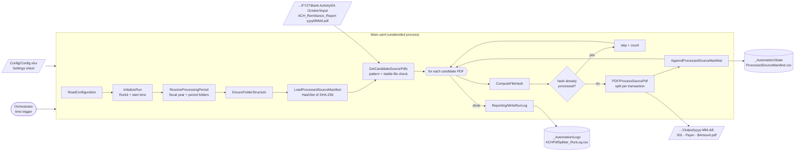

# ACH PDF Splitter Bot (UiPath, unattended)

[](https://github.com/Chris1112220/uipath-ach-pdf-splitter/actions/workflows/ci.yml)

An unattended UiPath process that takes the combined ACH payment-notification PDF a bank sends each day and splits it into **one PDF per payment**. Each file is named after the payer and amount (`001 - Northwind Traders - $1,250.00.pdf`) and saved in a dated folder under the correct fiscal year and period. The bot never processes the same report twice, and every run is logged.

> **Sanitized rebuild of a production bot.** I run this automation in production at work. This public copy keeps the workflow logic as it is but removes everything tied to my employer: the bank name, network shares, folder names, user paths, and all report data. The sample report and every payer, account and amount in this repository are **fictional** (see [`samples/`](samples/)).

## How it works

Each run follows the same path:

1. **Start with the merged PDF.** The input is one combined ACH remittance report: every payment for that day in a single file. A payment with a long remittance list can continue onto the next page.
2. **Split into one PDF per payment.** The bot reads the report page by page. When it reaches `END OF TRANSACTION`, those pages become one payment PDF, so a payment that spans pages stays together.
3. **Rename and file by fiscal period.** Each payment is saved as `{index} - {payer} - {amount}.pdf` (for example `001 - Northwind Traders - $1,250.00.pdf`) under the fiscal-year and period folder for the run date, in a dated subfolder taken from the report filename.
4. **SHA-256 skip check.** Before it writes anything, the bot hashes the source PDF. If that SHA-256 is already in the processed-source manifest, the report was filed on an earlier run, so this run skips it and leaves the payment PDFs in place.

The sections below cover the workflows, the fiscal-period folders, and the manifest in more detail.

## Status

**Version 1.0.1, the same version that runs in production**

- UiPath Studio 25.10 Windows project with C# expressions; 11 workflows; settings come from `Config/Config.xlsx`.
- Deployed to UiPath Orchestrator as an unattended process with a weekday-morning time trigger.
- Idempotent: a source report whose SHA-256 is already in the manifest is skipped, so running it again is always safe.
- Comes with a fictional 6-page sample report, the expected split output, and an offline Python simulator of the parsing rules.
- CI (GitHub Actions) checks every push: it runs the offline Python simulator against the sample and confirms the expected output and the skip on re-run, and it confirms every `.xaml` file is valid XML. It does not run the bot in UiPath Studio.

## Business impact

| | |
|---|---|
| **Estimated savings** | **≈ $50,000 / year** in staff time (my estimate of the labor the bot replaced) |
| **Manual process replaced** | Open each day's combined bank report, find where every transaction starts and ends, save each page range as its own PDF, type a name with payer and amount, and file it in the right fiscal-period folder |
| **Quality** | Same naming every time, no missed or duplicated transactions, and an audit trail (source hash, transaction count, run metrics) |
| **Operations** | Runs unattended on a schedule; nobody has to start it |

## Business problem

Cash and treasury teams receive ACH payments every day. The bank's remittance detail (who paid, how much, which invoices) comes as **one combined PDF**, and transactions vary in length: a payer with a long remittance list can run onto two or three pages.

To apply cash and keep backup for each deposit, someone used to split that PDF by hand, every day:

1. Open the report and scroll for each `END OF TRANSACTION`.
2. Work out each transaction's page range.
3. Extract the pages, then type a filename with the payer and the amount.
4. Save it in the correct fiscal-year / period / date folder.
5. Remember which reports were already done.

The rules never change and errors are easy to make (wrong page range, mistyped amount, a report done twice). That makes it a good job for an unattended bot.

## Architecture



### End-to-end flow

```text
Main.xaml
│
├── 01-02  Capture run time, resolve Config\Config.xlsx path
├── 03     Framework/ReadConfiguration.xaml         Settings sheet → case-insensitive dictionary;
│                                                    required keys, duplicates and typed values validated
├── 04-05  Framework/InitializeRun.xaml              RunId (GUID), run start time, run user
├── 06     Framework/ResolveProcessingPeriod.xaml    run date → fiscal year + period →
│                                                    source folder and output ("breakdown") folder paths
├── 07     Framework/EnsureFolderStructure.xaml      source folder must exist; output, state, logs and
│                                                    reporting folders are created if missing
├── 08     Framework/LoadProcessedSourceManifest.xaml  successful hashes → HashSet (O(1) lookups)
├── 09     Framework/GetCandidateSourcePdfs.xaml     files matching SourceFilePattern, sorted; files modified
│                                                    less than FileStableMinutes ago are deferred
├── 10     For each candidate
│     ├── Framework/ComputeFileHash.xaml             SHA-256 of the file bytes
│     ├── already in manifest?  → skip, SourcePdfsSkipped++
│     └── otherwise
│           ├── PDF/ProcessSourcePdf.xaml            split into one PDF per transaction
│           ├── Framework/AppendProcessedSourceManifest.xaml
│           └── add hash to in-memory set, update counters
└── 11-14  Reporting/WriteRunLog.xaml                one CSV row per run
```

### How the PDF split works (`PDF/ProcessSourcePdf.xaml`)

1. **Report date from the filename.** A standalone 8-digit `yyyyMMdd` token (e.g. `ACH_Remittance_Report 20260831.pdf`) becomes the report date and names the output folder (`DailyOutputFolderDateFormat`, default `yyyy-MM-dd`). The report date is used rather than the run date, so a late or re-run report still files under its own day.
2. **Page-by-page reading.** `Get PDF Page Count`, then `Read PDF Text` one page at a time. Each page's text is added to a transaction buffer, and the buffer's first page is remembered as the start page.
3. **Transaction boundary.** When the buffer contains `END OF TRANSACTION`, pages *start…current* make up one transaction, so multi-page transactions stay together.
4. **Parsing (regex):**
   - Payer: `ORIGINATOR INFORMATION … Company Name: <name>` up to the next `Identification:` (or a second `Company Name:` column).
   - Amount: a line starting `Amount: $#,###.##` (optionally followed by `CR`/`DB`/`DR`), with a looser fallback match.
5. **Safe filenames.** Characters that are illegal in Windows filenames are replaced, whitespace is collapsed, trailing dots are trimmed, and names are capped at 80 characters. A blank name falls back to `Unknown Company`.
6. **Output.** `OutputFileNameFormat` (`{Index:000} - {Company} - {Amount}.pdf`) is filled in and `Extract PDF Page Range` writes the file. The zero-padded index keeps report order and prevents name collisions when one payer pays twice in the same day.
7. **Completeness checks.** The run fails loudly if the PDF ends in the middle of a transaction (no closing marker) or if no transactions were found.

## Idempotency: the processed-source manifest

A scheduled bot will see the same folder many times, and people sometimes re-save or re-copy reports, so the bot recognizes reports **by content, not by filename**:

- Every candidate gets a **SHA-256 hash** of its bytes (`ComputeFileHash.xaml`).
- `_Automation\State\ProcessedSourceManifest.csv` keeps one row per report processed successfully:

  ```text
  FileHash,SourceFileName,ReportDate,ProcessedDateTime,TransactionCount,Status
  "909AED94…294E4B","ACH_Remittance_Report 20260831.pdf","2026-08-31","2026-10-08 16:59:29","5","Success"
  ```
- At start-up, rows with `Status = Success` are loaded into a case-insensitive `HashSet<string>`. A hash that is already in the set is skipped; a new one is processed, written to the manifest **right away**, and added to the in-memory set (so two identical copies in one run are processed only once).
- A small hand-written CSV parser handles quoted fields and escaped quotes, so the project doesn't depend on `Microsoft.VisualBasic.FileIO`.
- **Stable-file check:** files modified less than `FileStableMinutes` ago are *deferred* rather than processed, so a report that is still copying or syncing is never split half-written. The next scheduled run picks it up.

## Logging and run metrics

`Reporting/WriteRunLog.xaml` adds one row per execution to `_Automation\Logs\ACHPdfSplitter_RunLog.csv`:

| Column | Meaning |
|---|---|
| `RunId` | GUID for the run |
| `RunStartedAt` / `RunEndedAt` / `DurationMinutes` | timing |
| `RunBy` | Windows identity of the robot |
| `FiscalYear` / `FiscalPeriod` | period the run resolved to |
| `MatchedSourcePdfs` | files matching the pattern |
| `DeferredSourcePdfs` | matched but too new (still copying) |
| `SourcePdfsProcessed` / `SourcePdfsSkipped` | new vs. already-processed reports |
| `SplitPdfsCreated` | total transaction PDFs written |
| `Status` / `Notes` | outcome, manifest size and output root |

The CSV feeds a separate reporting workbook (path resolved from `SummaryWorkbookName`) that shows volume, time saved and estimated value. Each step also writes a readable message to the robot log.

## Fiscal-period folder logic

The folder tree follows the fiscal calendar, not the calendar year. With `FiscalYearStartMonth = 7` (a July to June fiscal year):

| Run date | Fiscal year | Period | Source folder |
|---|---|---|---|
| 2026-07-15 | FY27 | 01 | `C:\ACH\FY27\Bank Activity\01. July\Input` |
| 2026-10-08 | FY27 | 04 | `C:\ACH\FY27\Bank Activity\04. October\Input` |
| 2027-06-30 | FY27 | 12 | `C:\ACH\FY27\Bank Activity\12. June\Input` |

`period = ((month − startMonth + 12) mod 12) + 1`, and the fiscal year is named for the calendar year it ends in. Nothing is hard-coded, so the bot keeps working when a new fiscal year starts.

## Project structure

```text
uipath-ach-pdf-splitter
├── Main.xaml                                 entry point (unattended process)
├── project.json / project.uiproj / entry-points.json
├── .github/workflows/ci.yml                  CI: runs tools/verify_split.py on every push / PR
├── Config/
│   └── Config.xlsx                           Settings sheet (read by the bot) + Reference sheet (design notes)
├── Framework/
│   ├── ReadConfiguration.xaml
│   ├── InitializeRun.xaml
│   ├── ResolveProcessingPeriod.xaml
│   ├── EnsureFolderStructure.xaml
│   ├── LoadProcessedSourceManifest.xaml
│   ├── GetCandidateSourcePdfs.xaml
│   ├── ComputeFileHash.xaml
│   └── AppendProcessedSourceManifest.xaml
├── PDF/
│   └── ProcessSourcePdf.xaml                 page-by-page transaction splitter
├── Reporting/
│   └── WriteRunLog.xaml
├── samples/                                  FICTIONAL input report + expected split output
└── tools/
    ├── generate_sample_report.py             builds the fictional combined ACH PDF
    ├── simulate_split.py                     offline Python port of the split + manifest logic
    ├── verify_split.py                       CI check: XAML parses, sample split matches, re-run skips
    └── requirements.txt                      Python packages for the simulator and CI check
```

Each workflow takes `in_` / `out_` arguments, checks its inputs first, and returns an `out_Message` that `Main.xaml` writes to the log. Most logic is in small `Invoke Code` (C#) blocks, so each step is easy to read and test.

## Configuration (`Config/Config.xlsx` → `Settings`)

| Key | Sample value | Purpose |
|---|---|---|
| `DataRoot` | `C:\ACH` | Top-level business-data root (local folder or network share) |
| `FiscalYearStartMonth` | `7` | Month that is fiscal period 01 (1-12) |
| `FiscalYearFolderPattern` | `FY{YY}` | Fiscal-year folder, e.g. `FY27` |
| `BankActivityFolderName` | `Bank Activity` | Folder under each fiscal year |
| `FiscalPeriodFolderPattern` | `{Period:00}. {MonthName}` | e.g. `04. October` |
| `SourceSubfolderName` | `Input` | Where combined reports arrive |
| `BreakdownSubfolderName` | `Output` | Where split PDFs are written (sibling of the source folder) |
| `SourceFilePattern` | `ACH_Remittance_Report *.pdf` | Eligible source files (must contain a `yyyyMMdd` date) |
| `DailyOutputFolderDateFormat` | `yyyy-MM-dd` | Dated output subfolder |
| `OutputFileNameFormat` | `{Index:000} - {Company} - {Amount}.pdf` | Split-file naming |
| `FileStableMinutes` | `2` | Minimum file age before processing (0-120) |
| `HashAlgorithm` | `SHA256` | Fingerprint for idempotency (only SHA256 supported) |
| `AutomationFolderName` / `AutomationAppFolderName` | `_Automation` / `ACH_PDF_Splitter` | Runtime-state root under `DataRoot` |
| `StateFolderName` / `LogsFolderName` / `ReportingFolderName` | `State` / `Logs` / `Reporting` | Runtime subfolders |
| `ManifestFileName` / `RunLogFileName` / `SummaryWorkbookName` | `ProcessedSourceManifest.csv` / `ACHPdfSplitter_RunLog.csv` / `ACHPdfSplitter_Summary.xlsx` | State, log and reporting files |
| `ConfigVersion` / `ProjectName` | `1.0` / `ACHPdfSplitter_Service` | Contract version and logical name |

All keys are required; the bot stops at start-up if a key is missing, blank, duplicated, or has a value of the wrong type. **No credentials live in the config.** The bot needs only file-system access.

## Setup

Run the full process in UiPath Studio, or check the same split and skip rules with the Python tools. Commands below use the repository root as the working directory.

### Prerequisites

**UiPath Studio (full process)**

- Windows, with UiPath Studio 25.10 or newer. This is a Windows project that uses C# expressions.
- Packages restore from `project.json`: `UiPath.System.Activities`, `UiPath.Excel.Activities`, `UiPath.PDF.Activities`, among others. Open `project.json` in Studio and let the restore finish before you run.

**Python (offline check)**

- Python 3.11, the version [CI](.github/workflows/ci.yml) uses.
- From the repo root, install the simulator dependency. `tools/requirements.txt` installs `pypdf`:

  ```bash
  pip install -r tools/requirements.txt
  ```

### Run the process in Studio

1. Clone the repo and open `project.json` in Studio.
2. Open `Config/Config.xlsx`, Settings sheet. `DataRoot` defaults to `C:\ACH`. For a quick test, set `FileStableMinutes` to `0`. At the default of `2`, a file copied in the last two minutes is deferred until a later run, so a report that is still copying is never split half-written.
3. Create the source folder for the fiscal period of the day you run the bot. With the sample settings (`FiscalYearStartMonth` = `7`, a July-to-June year), a run in October 2026 uses:

   ```text
   C:\ACH\FY27\Bank Activity\04. October\Input
   ```

   Create that Input folder yourself. The bot creates the Output folder, and it creates state, logs, and reporting under `C:\ACH\_Automation\ACH_PDF_Splitter\`. For another run date, build the same path from [Fiscal-period folder logic](#fiscal-period-folder-logic): `C:\ACH\FY{yy}\Bank Activity\{period}. {Month}\Input`.

4. Copy `samples/input/ACH_Remittance_Report 20260831.pdf` into that Input folder. The `20260831` in the filename is the report date, and it names the output subfolder (`2026-08-31`). The Input folder follows the run date, so this report belongs in October's Input folder when you run the bot in October 2026.
5. Run `Main.xaml`. You should get five PDFs in `C:\ACH\FY27\Bank Activity\04. October\Output\2026-08-31\` that match [`samples/expected-output/2026-08-31`](samples/expected-output/2026-08-31), plus a manifest row and a run-log row under `C:\ACH\_Automation\ACH_PDF_Splitter\`.
6. Run `Main.xaml` again. The report is skipped (`SourcePdfsSkipped = 1`, `SplitPdfsCreated = 0`), and the five PDFs from the first run stay in place.

### Check the split without Studio

From the repository root, after the install above:

```bash
python tools/simulate_split.py "samples/input/ACH_Remittance_Report 20260831.pdf" --out samples/output
```

The first run writes five PDFs under `samples/output/2026-08-31/` and a manifest at `samples/output/_Automation/State/ProcessedSourceManifest.csv`. That output folder is gitignored (`samples/output/` in `.gitignore`).

Run the same command a second time. The simulator prints `Skipping already-processed source PDF`, because the report's SHA-256 is already in the manifest, and it leaves the five PDFs as they are.

To run the same checks CI runs (well-formed `.xaml`, sample split matches, re-run skips):

```bash
python tools/verify_split.py
```

### Production

Publish to Orchestrator as an unattended process and attach a time trigger (weekday mornings in my deployment). A scheduled, idempotent scan recovers more cleanly from machine or network interruptions than a long-running file watcher.

## Adapting it to another bank's report

The parsing depends only on a handful of labels: `ORIGINATOR INFORMATION`, `Company Name:`, `Identification:`, `Amount:` and `END OF TRANSACTION`. To support a different layout, change the two regular expressions and the end marker in `PDF/ProcessSourcePdf.xaml` (and in `tools/simulate_split.py`), then confirm the result against a fictional sample.

## Known limitations / roadmap

Kept as-is from the production version, so this repo reflects what actually runs:

- **Per-file error isolation:** a single bad source PDF (corrupt, password-protected, or unparseable) currently stops the run. Next step: Try/Catch per file, with a `Failed` manifest status.
- **Failed-run logging:** the run log is written at the end of a successful run. A Try/Catch/Finally around `Main` would log failed runs too.
- **Transactions must start on a new page.** That is true of the source format, and the simulator's sample follows it.
- `FiscalYearStartMonth = 1` (a calendar fiscal year) would label the year one higher than expected; the formula assumes a mid-year start.
- ~~Leftover `DEBUG -` WriteLine activities in `ProcessSourcePdf.xaml`~~ **Fixed:** converted to Log Message activities at Trace level.
- Move to a dedicated always-on VM with a service account.

## Tech

UiPath Studio 25.10 (C#) · UiPath Orchestrator (unattended, time trigger) · UiPath PDF Activities (`Read PDF Text`, `Get PDF Page Count`, `Extract PDF Page Range`) · Excel Activities (`Read Range`) · `Invoke Code` (C#) · SHA-256 · CSV state and logging · Python (`reportlab`, `pypdf`) for fictional sample data and simulation

## License

[MIT](LICENSE)
